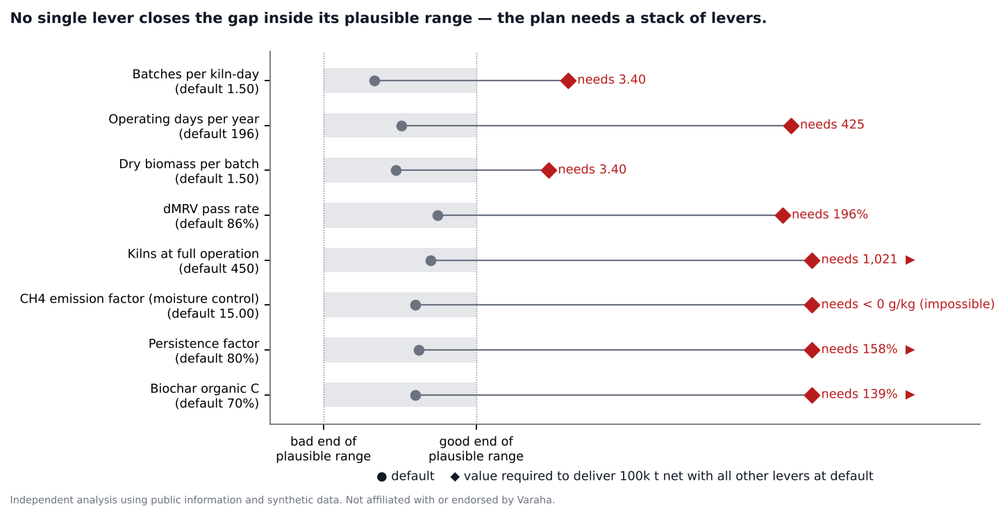
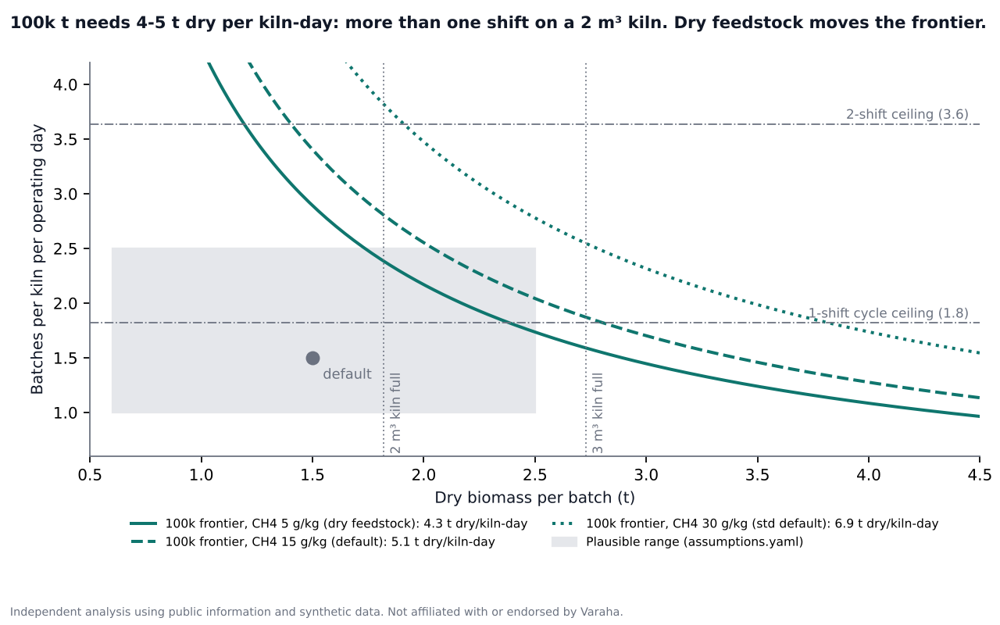
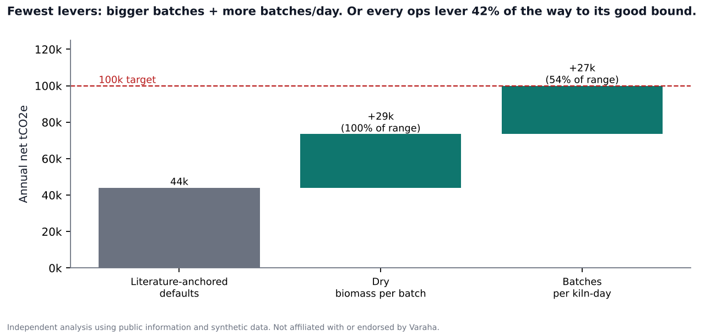
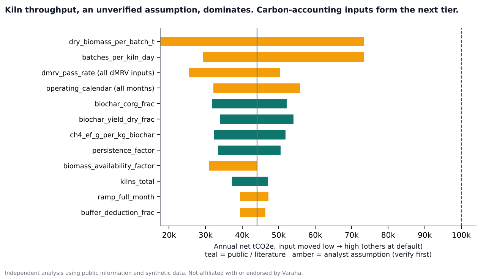

# Phase 1 findings: assumptions and "what has to be true"

> **Phase 1 snapshot (literature-default view).** Decision taken after this note: keep yaml defaults literature-anchored and add a *Plan-implied* scenario (2.5 t batches, 1.8 batches/day, dried feedstock) that the control tower tracks. Current figures for every scenario are in the README and `docs/key_numbers.json`.

> Independent analysis using public information and synthetic data. Not affiliated with or endorsed by Varaha.

**Scope:** a 450-kiln distributed Kon-Tiki network modelled on Agnisparsh, aiming for 100,000 tCO₂e of net removals in 2027.
**Inputs:** `assumptions.yaml` (89 parameters: 5 public, 9 literature, 75 analyst assumptions; table in `docs/assumptions_table.md`).
**Reproduce:** `python -m tools.phase1_report`. Every number below comes from `docs/phase1/key_numbers.json`.

## Bottom line

1. **On literature-anchored defaults the network delivers about 44k t net (44% of target).** That is not a verdict on the plan. The gap sits almost entirely in parameters that are not public: kiln throughput, how the methodology treats methane, and persistence.
2. **No single lever closes the gap within its plausible range.** Throughput per kiln has to roughly double, from 2.25 to about 5.1 t dry feedstock per kiln-day, or several levers have to move together.
3. **There is a coherent operating point that hits the target.** Three things together deliver about 104k t:
   - ~2.5 t dry batches, which means kilns of roughly 2.75 m³;
   - 1.8 batches per kiln-day, which is the single-shift cycle ceiling;
   - feedstock dried to ≤15% moisture, so CH₄ falls to about 5 g/kg.

   Calibrating against real batch logs means testing those three things.

## 1. The arithmetic

| | Value |
|---|---:|
| Brief anchor: 100,000 ÷ 450 kilns | 222 t net per kiln-year |
| … at an 85% pass rate | 261 t gross per kiln-year |
| Adjusted for ramp (fleet is 84% online on an operating-day-weighted basis) | **263 t net per kiln-year** |
| Model default per full kiln-year | 116 t net |

**Default bridge for 2027:**

| Step | tCO₂e |
|---|---:|
| Gross (all batches) | 69.8k |
| dMRV rejections | −9.6k |
| Project emissions | −13.8k |
| Buffer | −2.3k |
| **Net** | **44.1k** |

The first half of the year carries 53% of net tonnes. The monsoon months (Jun–Sep) carry only 13%, so **slippage in Q1–Q2 cannot be recovered in Q3.**

## 2. What has to be true

The table solves for each lever on its own, with every other lever held at its default. Net tonnes are affine in each lever, so the solve is exact and the tests confirm it within 0.5%.

| Lever | Default | Required for 100k t | Change | Plausible range | Verdict |
|---|---:|---:|---:|---|---|
| Batches per kiln-day | 1.50 | 3.40 | +127% | 1.00 – 2.50 | Beyond plausible range |
| Operating days per year | 196 | 425 | +117% | 150 – 240 | Infeasible alone (exceeds calendar) |
| Dry biomass per batch | 1.50 t | 3.40 t | +127% | 0.60 – 2.50 | Beyond plausible range |
| dMRV pass rate | 86% | 196% | +127% | 50% – 98% | Infeasible alone (>100%) |
| Kilns at full operation | 450 | 1,021 | +127% | 380 – 480 | Beyond plausible range |
| CH₄ emission factor (moisture control) | 15 g/kg | < 0 | n/a | 5 – 30 | Infeasible alone |
| Persistence factor | 0.80 | 1.58 | +98% | 0.65 – 0.89 | Infeasible alone (>1) |
| Biochar organic C | 0.70 | 1.39 | +98% | 0.55 – 0.80 | Infeasible alone (>1) |

**The binding constraint is throughput per kiln, and it runs into two physical limits:**
- **Cycle time.** A 3 h burn, 1 h quench and 1.5 h handling allow at most 1.8 batches per 10-hour shift, or 3.6 with two shifts.
- **Kiln volume.** A full 2 m³ kiln holds about 1.8 t dry feedstock at default yield and char density. The solver's 3.4 t batch would overfill it by 87%.

**Two ways to stack the levers:**
- **Fewest levers.** Move dry biomass per batch to 2.5 t, the top of its range, then batches per day to 2.04. That is above the single-shift ceiling, so it needs a partial second shift or a shorter cycle.
- **Spread.** Move every operational lever 42% of the way from its default to its good bound. The levers are batch size, batches per day, CH₄, dMRV, calendar, kiln count and ramp.

**Combined calibrations, net t in 2027:**

| Calibration | Net t | Kiln fill at 2 m³ |
|---|---:|---:|
| 2.5 t × 1.8/day, CH₄ 5 g/kg | 103.7k | 138% (needs ~2.75 m³ kiln) |
| …plus persistence 0.89 (IPCC high-temperature value) | 116.6k | 138% |
| 2.0 t × 1.8/day, CH₄ 5, persistence 0.89 | 93.3k | 110% |
| Defaults, but CH₄ at 30 g/kg (common standard default) | 32.4k | 82% |

## 3. Which assumptions dominate

**Tier 1: throughput (analyst assumptions).**
- Dry biomass per batch swings net from 18k to 73k.
- Batches per kiln-day swings it from 29k to 73k.
- Both are unverified and both are measurable in week one.

**Tier 2: execution (analyst assumptions).**
- dMRV pass rate: 26k to 50k as every dMRV input moves together.
- Operating calendar: 32k to 56k.

**Tier 3: carbon accounting (literature).** Each input swings net by about ±17–20k:
- biochar organic C;
- yield;
- CH₄ emission factor;
- persistence.

These are literature-anchored, but the right value depends on feedstock and on the methodology.

**Second order:** kiln count (±10k), ramp timing, buffer and relocation downtime.

## 4. Which values look plausible and which need calibration

| Assumption | Default | Judgement |
|---|---|---|
| Yield 22%, H/Corg 0.25, 3 h burn | Schmidt 2016 | Plausible for the process. Measured mostly on woody and invasive-shrub feedstock, so cotton and pigeon-pea stalk need their own lab data. |
| Biochar organic C 0.70 | Below Schmidt's 75.5% woody mean | Plausible for semi-woody stalks. High-ash residues tested at 54–55%. **Calibrate with first lab results.** |
| CH₄ 15 g/kg | Midpoint | **Biggest accounting judgement.** It takes 7% of gross at 5 g/kg, 20% at 15 g/kg and 41% at 30 g/kg. Lotz & Schmidt (2026) tie low CH₄ to feedstock at ≤15% moisture, so moisture is an ops lever. The open question is whether Rainbow v1.0 credits measured CH₄ or applies a default. |
| Persistence 0.80 | IPCC medium-temperature value | Conservative. Kon-Tiki reaches 680–750 °C, which would support 0.89. Methodology-dependent. |
| dMRV pass 86% | Six evidence elements, 30% remediation, 2% quality and 1% audit rejection | Matches the brief's 85% anchor, but every component is a guess. **The first issuance (Jan 2027) will show the real rejection reasons.** |
| 196 operating days | Monsoon collapse, festival dips | Plausible. Real calendars vary by district. |
| Ramp: 45% of kilns in Jan, 100% by May | Analyst assumption | Matters less than expected (±7–8k), because the ramp overlaps months of moderate capacity. |
| Direct field labour ₹2.4 per kg biochar | Derived | Compare with the public ~₹10/kg partner fee from Banni. The fee presumably bundles supervision, transport, application and margin. **This is the calibration check for Phase 3 unit costs.** |

**Default change made in this phase:** kiln volume moved from 1.5 to 2.0 m³. The original pairing of a 1.5 t batch with a 1.5 m³ kiln overfilled the kiln at default yield and char density (110%). It now sits at 82%, and a fill check runs in the model.

## 5. Operating footprint implied by 100k t at default unit factors

**Feedstock:**
- ~350k t dry residue, or ~427k t as received at 18% moisture.
- About ₹85 crore of biomass purchases at ₹2/kg.

**Supply base:**
- About 1,670 villages and about 250k supplying farmers. This assumes 300 t surplus per village per season, 35% supplied and two seasons a year.
- For scale, that is more than the ~170–175k farmers the company reports across all its projects (TechCrunch, Feb 2026). It is sensitive to the 35% supply share, which in turn depends on paying farmers reliably.
- **The farmer-payment layer is part of the core delivery system, and it is where integrity becomes a commercial moat.**

**People:** 1,350 operators. At 4% monthly attrition that means about 650 replacements a year, or roughly 55 trainees a month in steady state.

## 6. What to verify first, ranked by tonnes at stake

1. **Kiln size, t dry per batch and batches per kiln-day** (swing up to ~56k). Source: batch logs from the first month at 3–5 sites, plus the kiln spec sheet.
2. **Methodology rules in Rainbow Distributed Open-Kiln v1.0** (~17–20k each):
   - CH₄ treatment: measured or default factor;
   - persistence factor;
   - buffer or uncertainty deduction;
   - H/Corg threshold.
3. **dMRV rejection reasons and remediation rate** (~25k). Source: the first issuance package, due Jan 2027.
4. **Feedstock moisture at the kiln and lab C content per residue type** (CH₄ and C swings). Get a moisture meter onto every site.
5. **Operating calendar and ramp actuals.** How many kilns were already producing in Nov–Dec 2026?
6. **What ">100,000 t planned for 2027" counts.** It could mean 2027 issuances, which may include late-2026 production, or 2027 production vintage. If late-2026 batches count, the 2027 requirement falls.
7. **Village supply share versus payment lag.** This is the input to the Phase 2 causal story.

## Decision needed before Phase 2

Under literature defaults, the executive summary would show a P50 near 44k against 100k. **Recommendation:**
- Keep `assumptions.yaml` defaults literature-anchored, since that is the honest prior.
- Add a clearly labelled **"Plan-implied" scenario**: 2.5 t batches, 1.8 batches/day, dried feedstock.
- The control tower tracks actuals against the plan-implied scenario. The literature case appears as the calibration-risk view.

This keeps the tone of "here is what has to be true and how we would know in week 4", without quietly tuning defaults to hit the target.
